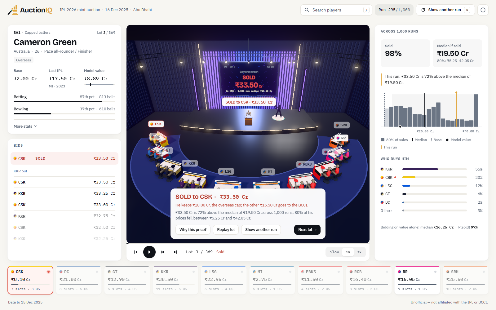

<p align="center"></p>

# AuctionIQ

**The IPL 2026 mini-auction, simulated 1,000 times with only what was known on the morning of
16 December 2025, and replayed bid by bid in a 3D auction room.**

**Live:** [auctioniq-chi.vercel.app](https://auctioniq-chi.vercel.app) · mirror on
[GitHub Pages](https://fuadahamed91.github.io/auctioniq/)

Ten rule-based franchise agents, one per team, bid only for the players they need, up to a price
they can explain. Pick any player and the app fast-forwards the auction to his lot and plays one of
the 1,000 runs like a live auction, with every team's reasons; only when the hammer falls does it
show how that price compares with all 1,000 runs.

> Unofficial. Not affiliated with the IPL or the BCCI. Teams appear by their codes and team colours only: no logos, photos or likenesses.



## How it did on the real 2026 auction

The 1,000 runs were made with only what was known on the morning of the auction, then scored
against what really happened with `python -m analysis.compare_2026` (the app never reads the real
results). The first comparison, run before any change, is the honest held-out test
([`analysis/out/comparison_2026.md`](analysis/out/comparison_2026.md)):

- **Sold or unsold:** it separated the players who sold from those who did not far better than going
  by base price (AUC 0.81 against 0.62).
- **Who buys him:** the real buyer was among its three likeliest teams 45% of the time, against 30%
  by chance. Team needs alone, before any simulation, already picked the buyer among the three
  neediest teams 42% of the time.
- **The price range:** 73% of real prices fell inside its 80% range.

| Real 2026 auction | Held-out test | After seeing the results |
|---|---|---|
| Sold/unsold AUC (base price: 0.62) | 0.81 | 0.81 |
| Real buyer in the top 3 (30% by chance) | 45% | 45% |
| Real prices inside the 80% range | 73% | 70% |
| Price rank, Spearman (base price: 0.64) | 0.67 | 0.74 |

The right-hand column ([`comparison_2026_after_seeing.md`](analysis/out/comparison_2026_after_seeing.md))
comes from the model after the pre-auction buzz research was added and the weights re-tuned, on the
2024 back-test only. The research used only sources dated before the auction, but it was gathered
after the auction took place, so that column is not a clean test. Where the model falls short is
set out at the end of this page, under [Known weak points](#known-weak-points).

## What the back-test says

The whole pipeline was re-run for the **2024 mini-auction** with only what was known before it
(skills to 18 Dec 2023, value model trained on the 2020, 2021 and 2023 mini-auctions) and scored
against what really happened. Weights and add-ons were chosen on this auction, so these are
tuning-set numbers.

| Model (2024 back-test) | MAE, log price ↓ | Spearman ↑ | Sold/unsold AUC ↑ | Real buyer in top 3 ↑ | 80% range coverage |
|---|---|---|---|---|---|
| Value + needs (the agents' core) | 0.770 | 0.667 | 0.810 | 33% | 74% |
| **+ matchups ✓ kept (the model)** | 0.765 | 0.666 | 0.810 | 38% | 72% |
| + start speed ✗ dropped | 0.762 | 0.670 | 0.812 | 36% | 76% |
| + home fit ✗ dropped | 0.769 | 0.668 | 0.813 | 31% | 74% |
| Without needs | 0.757 | 0.699 | 0.811 | 31% | 72% |
| Need only (no value) | 0.791 | 0.672 | 0.741 | 22% | 68% |
| Base price | 0.853 | 0.650 | 0.636 | – | 58% |
| Last IPL price | 0.845 | 0.649 | 0.654 | – | 43% |

In plain terms, on 2024:

- **Sold or unsold:** called right for 85% of the 332 players (saying "unsold" for everyone scores 78%).
- **Price:** for 53% of the 72 players sold, the real price was within 25% of the simulated median
  (81% for buys up to ₹1 Cr), and 72% fell inside the 80% range.
- **Buyer:** the real buyer was among the three likeliest teams 38% of the time (30% by chance; the
  figure moves about 5 points between identical batches of runs).
- **Team needs are the core** of every agent: they decide who bids at all. Tested directly, with no
  simulation in between, the real buyer was one of the three teams with the greatest pre-auction
  need for the player in 43% of buys (30% by chance). **Add-ons:** matchups kept (buyer accuracy just
  beyond the simulation's seed-to-seed noise); start speed and home fit dropped. With 72 sales
  nothing clears a strict 95% test; the paired intervals are in `analysis/out/validation_2024.json`
  and the app.
- **The value model alone**, before any simulation, on every past auction with earlier auctions of
  its kind to learn from (mega and mini auctions are priced differently, so they are never mixed):

  | Auction | Trained on | Sold/unsold AUC | Price rank (Spearman) | MAE, log price |
  |---|---|---|---|---|
  | 2021 mini | 2020 | 0.82 | 0.77 | 0.79 |
  | 2023 mini | 2020, 2021 | 0.83 | 0.81 | 0.65 |
  | 2024 mini | 2020, 2021, 2023 | 0.81 | 0.70 | 0.88 |
  | 2025 mega | 2022 | 0.87 | 0.85 | 0.60 |

- **Research into earlier auctions.** The 2018 mega and 2019–2021 mini auctions were rebuilt from the
  archived official records, so players carry their earlier IPL price (Pat Cummins: ₹15.5 Cr in 2020)
  and the 2026 model learns from four mini auctions instead of two. Mixing in mega-auction data, even
  with a measure of how many similar players each auction offered, did worse on the back-tests.
- **Pre-auction buzz.** For the 2020–2026 auctions a research step recorded which uncapped players
  were named ones to watch, reported at franchise trials, or had a standout state T20 league season,
  from sources dated before each auction (`data/research/buzz.csv`). Flagged players sold 40–55% of the
  time against 17–20% for the rest, and the signal improved all three mini back-tests. Reported
  injuries and part-season availability were researched the same way and dropped: they barely moved
  the back-tests.
- **Team habits, tested.** Each franchise's buying habits since 2018 were profiled (MI buy the
  youngest, PBKS spend most on stars and all-rounders, CSK and KKR bring back former players) and
  tested on later auctions: in mini auctions they picked the real buyer no better than chance, so the
  agents bid on each team's current gaps and money, and the habits appear in each team's panel as
  background, with cited reporting ([`docs/TEAMS.md`](docs/TEAMS.md)).


## How it works

```
Cricsheet ball-by-ball ──► skills, roles, matchups ──┐
cricketdata player_meta ─┘                           ├─► value model (censored regression)
official auction lists, caps, purses, squads ────────┤
                                                     └─► 10 franchise agents ─► auction engine ─► 1,000 runs ─► web app
```

1. **Skills** (`pipeline/skills.py`). Every ball since 2017 in the IPL, T20Is between full members,
   the Syed Mushtaq Ali Trophy and ten major leagues (The Hundred skipped) is worth the runs it made
   plus the change in run expectancy, against the average for the same phase at the same venue.
   Adjusted for league strength, weighted toward recent seasons, shrunk toward average when the
   evidence is thin, ball counts kept. Roles come from usage; tags record matchups against six
   bowler types, start speed, keeper, left-handed bat and left-arm pace.
2. **Home grounds** (`pipeline/venues.py`). Runs per over, boundary rate, pace and spin economy and
   wickets at each team's grounds, weighted by games hosted.
3. **Value** (`analysis/value_model.py`). A censored (Tobit) ridge regression of log price on skill,
   role, age, overseas and capped status, international caps, base price, previous IPL price, how far
   down the official list the player's set comes and pre-auction buzz for uncapped players, with an
   80% interval. Unsold players count as
   "price below base". Fitted only on earlier auctions of the same kind: mini and mega auctions are
   priced differently, so they are never mixed.
4. **Needs** (`engine/needs.py`). Squad template from the role mix of recent IPL squads; depth gaps,
   upgrade gaps, keepers, and lineup weaknesses (matchups: a batting core that struggles against a
   bowler type, or no left-arm pace). How fast openers and finishers start (start speed) and home fit
   are built and were tested, but the 2024 back-test dropped them.
5. **Agents** (`engine/agents.py`). Gate: role need, squad slot, overseas slot, affordability.
   Walk-away price = value × need × scarcity × purse pressure × home fit × style × market × noise,
   where *market* is how the whole room rates the player that run. Each lot is settled from the
   walk-away prices alone; the bid-by-bid replay is built afterwards, two paddles at a time as in the
   room (when one team backs out, the next comes in), and cannot change the result.
6. **Engine** (`engine/auction.py`). The real procedure, researched in [`docs/AUCTION.md`](docs/AUCTION.md):
   set order, random draw inside sets, price-point bid ladder, accelerated rounds from player 71,
   repeated rounds while squads fill, purse reserve, overseas fee cap.
7. **Monte Carlo** (`engine/montecarlo.py`). 1,000 seeded runs; every run replays exactly and writes
   an event log (`engine/out/sample_run_0000.jsonl.gz` is run 0; the rest are regenerated by the export).

Full method: [`docs/METHOD.md`](docs/METHOD.md). Rules with sources: [`docs/RULES.md`](docs/RULES.md).
Data sources and checks: [`data/SOURCES.md`](data/SOURCES.md).

## No peeking

- Matches dated 16 Dec 2025 or later are dropped (`tests/test_data.py` checks it).
- The 2026 simulation learns from the 2020, 2021, 2023 and 2024 mini-auctions (prices from every
  auction since 2018, mega ones included, count only as a player's previous price) and uses the 2026
  list, purses, slots and retained squads. The 2024 back-test uses only what was known before
  19 Dec 2023.
- The real 2026 results live in `data/actual_2026/` and are read only by `analysis/compare_2026.py`,
  a separate script for the demo that the app never runs. A test fails if any other code reads them.

## Run it

```bash
pip install -r requirements.txt
python -m pipeline.fetch            # Cricsheet archives, register, player_meta (once)
python -m pipeline.register         # auction names -> Cricsheet ids
python -m pipeline.deliveries       # parse ball-by-ball (cached)
python -m analysis.tune             # 2024 back-test: tuning + ablation
python -m engine.export             # 1,000 runs of 2026 -> web/public/data
python -m analysis.compare_2026     # for the demo only: the 1,000 runs vs the real 2026 auction
pytest
cd web && npm ci && npm run dev     # the app
```

The 3D room is built by a Blender script, run headless:
`blender -b --factory-startup -P blender/build_room.py` (writes `web/public/assets/room.glb`, Draco, about 370 KB):
a dark broadcast hall with an LED wall, a lighting truss and a stone floor. The app paints team colours on the desks,
nameplates, paddles and the representatives' kits, and lights the hall (warm key, truss spots, a glow on the lamps
and the LED wall, stepped down automatically on slower graphics).

In the app: pick any player (`/`), and the auction fast-forwards to his lot in one of his runs, picked
at random from six drawn from the 1,000, and plays it at presentation pace like a live auction. The
model's value, the 1,000-run numbers and each team's limit stay sealed until the hammer falls; then a
result card says how this run's price compares with the median and the 80% range of all the runs:
replay the lot, show another run, or ask "Why this price?". Click any table to hear its analyst: a
few sentences, in cricket terms, on why that team went for the player and why it stopped. The analysts are written rules that read the same decisions
the agents made, so they never contradict the auction. `N` shows another run, `Space` pauses or
carries on with the auction, `0`/`1`/`3` set the speed (Slow, 1×, 3×). `?2d` forces the 2D room; links like `#p=7&r=0` open a player and run.

## Repository

| Folder | What's in it |
|---|---|
| `pipeline/` | Cricsheet download and parsing, name matching, skills, roles, venues |
| `engine/` | Rules, needs, agents, auction engine, Monte Carlo, export for the app |
| `analysis/` | Value model, metrics, 2024 tuning and ablation, the 2026 comparison script |
| `blender/` | The room, as a Python script |
| `web/` | Vite + Three.js app; precomputed data in `web/public/data` |
| `data/` | Auction lists, purses, squads, name map, sources; `actual_2026/` for the comparison only |
| `tests/` | Rules, engine invariants, value model, data and leakage checks |

## Known weak points

- **Exact prices.** On the held-out 2026 test its typical price miss (MAE 0.68 on log price) was no
  better than simply taking each player's base price (0.615), and its price order was only a little
  better (Spearman 0.67 against 0.64). With the buzz research added afterwards it drew level (MAE
  0.61). It is much better at who sells, who buys and the likely range than at the exact figure.
- **Star bidding wars are under-priced.** In the 2024 back-test only 5 of the 18 buys of ₹5 Cr or
  more came within a factor of two of the median (Mitchell Starc went for ₹24.75 Cr against a median
  of ₹3.80 Cr; Pat Cummins's ₹20.50 Cr fell inside his range). Bidding wars for a handful of stars
  are beyond any public data.
- **Hype buys.** The biggest 2026 misses were uncapped players bought on hype: Kartik Sharma and
  Prashant Veer went for ₹14.20 Cr each, against simulated medians of ₹35 L and ₹60 L.
- **Ranges a little narrow.** The 80% ranges caught 72–73% of real prices in 2024 and 2026, a little
  under the 80% they promise.

## Data and credits

Ball-by-ball data from [Cricsheet](https://cricsheet.org) (Open Data Commons Attribution License);
player metadata from the [cricketdata](https://github.com/robjhyndman/cricketdata) R package;
auction lists, purses and squads from the public sources listed in `data/SOURCES.md`.
Code under the MIT licence.
